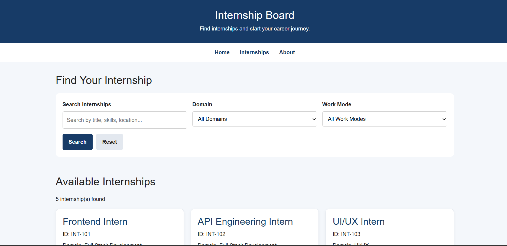
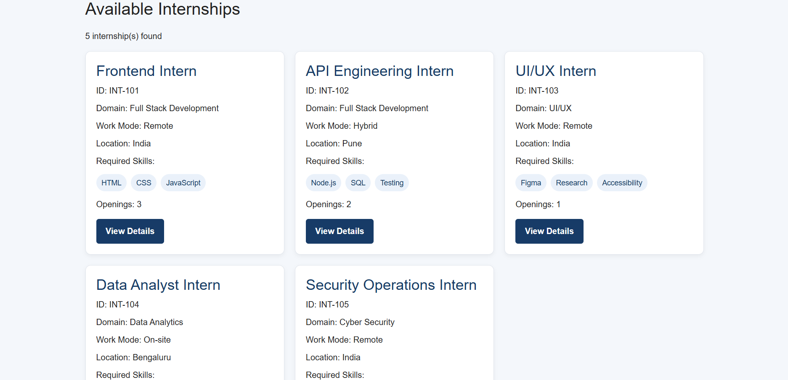
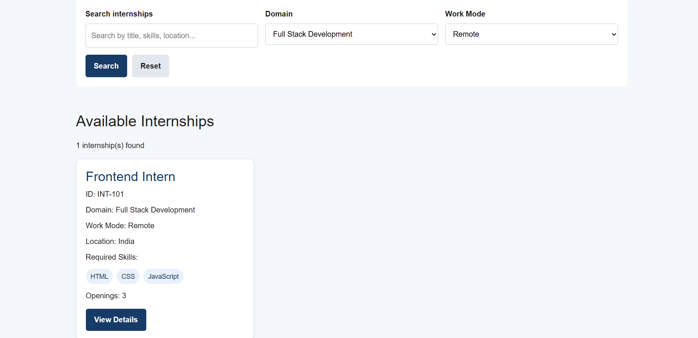
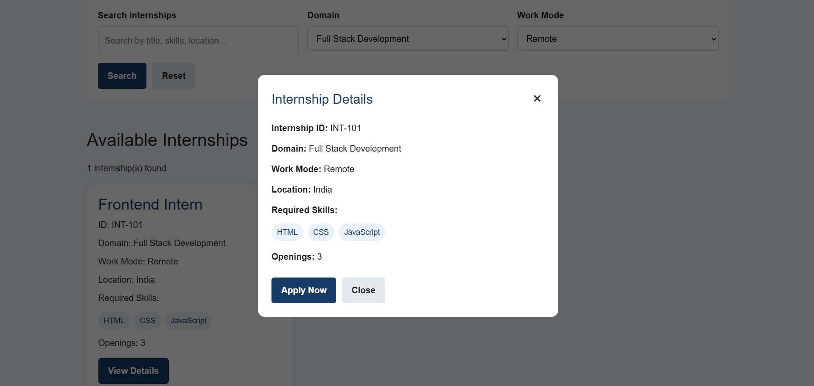
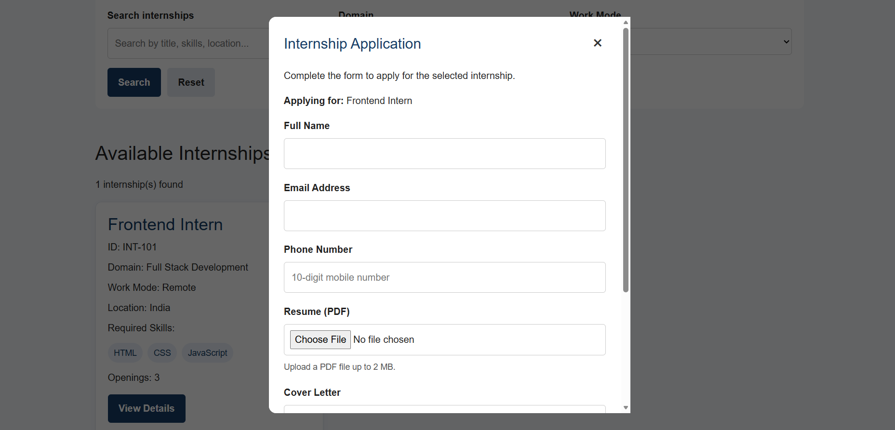

# Responsive Internship Board

## Project Overview
Responsive Internship Board is a web application that helps students
explore internship opportunities, search internships, filter listings,
view internship details, and submit application information.

## Features
- Responsive internship listing cards
- Search internships by title and skills
- Filter internships by domain
- Filter internships by work mode
- View internship details
- Internship application form
- Applicant form validation
- Loading, empty, and error state UI
- Responsive layout for mobile and desktop

## Technologies Used
- HTML5
- CSS3
- JavaScript
- Bootstrap 5

## Internship Dataset
The application includes five sample internship records:
- Frontend Intern
- API Engineering Intern
- UI/UX Intern
- Data Analyst Intern
- Security Operations Intern

## How to Run
1. Download or clone this repository.
2. Open the project folder in Visual Studio Code.
3. Open `index.html` in a browser.
4. Alternatively, use the VS Code Live Server extension.

## Project Files
- `index.html` - Application structure
- `style.css` - Styling and responsive layout
- `script.js` - Search, filters, internship details, and form validation

## Current Limitations
This version uses sample internship data and frontend
application validation.

Applications are not currently stored in a database
or submitted to a backend server.

## Future Improvements
- Backend integration
- Database storage
- Server-side validation
- Application management
- Deployment

## Author
MCA Student

## Screenshots

### Homepage

### Internship Listings

### Search and Filter Results

### Internship Details

### Application Form

